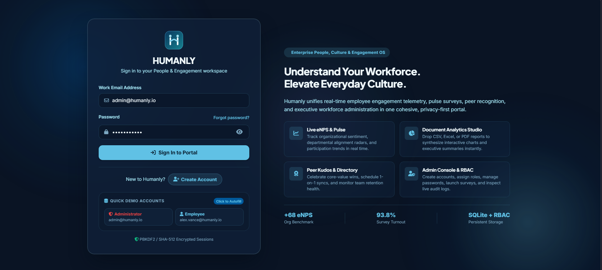
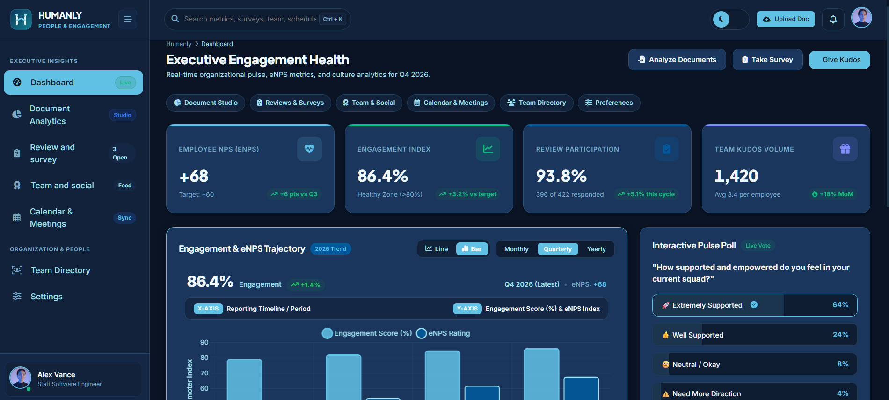
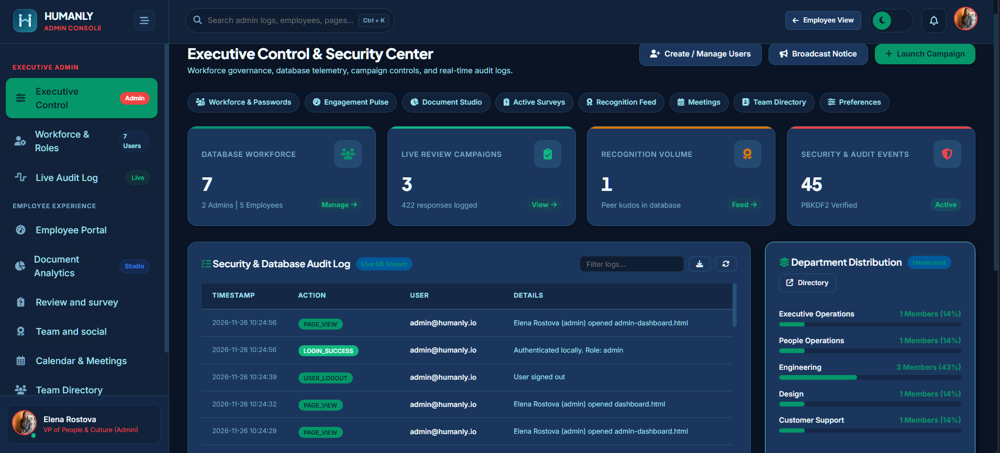

# HUMANLY: Enterprise People, Culture and Organizational Engagement Platform

Humanly is an enterprise-grade people analytics, employee engagement, and workplace culture platform. Engineered with a high-contrast solid and frosted-glass design system, client-side route protection, role-based access control (RBAC), and a zero-dependency SQLite relational database backend, the platform delivers a cohesive operational environment for leadership, people operations, and employees.

## Platform Visual Previews

1. Split-Screen Authentication Portal

The sign-in portal features a frosted glass authentication card on the left with work email and password verification, password visibility toggle, and quick demo account autofill, paired with a background-integrated platform overview on the right.

2. Employee Engagement Dashboard

The employee workspace provides real-time organizational pulse metrics (eNPS, Engagement Index, Review Participation, Kudos Volume), interactive trajectory charts, live pulse polling, departmental alignment radars, and quick navigation across all modules.

3. Executive Admin Console

The Executive Control Center enables administrators to monitor database workforce counts, manage review campaigns, broadcast company-wide announcements, inspect department headcount distribution, and track live security and employee activity audit logs.

Core Capabilities and Features

Authentication, RBAC, and Session Security

- Cryptographic Password Security: Salted password hashing via PBKDF2 with SHA-512 and 100,000 iterations, paired with constant-time verification.
- Bearer Token Sessions: Cryptographically random 64-character session tokens stored in SQLite with 48-hour server expiration.
- Role-Based Access Control: Strict separation between Standard Employee, HR Manager, and Administrator views. Non-administrative accounts are restricted from accessing Admin Console routes.
- 15-Minute Employee Session Timeout: Active inactivity monitoring for employee accounts. If an employee switches browser tabs and returns between 0.1 and 2 minutes (or reaches the final 2 minutes of their session), a countdown modal prompts them to either Stay Signed In or Sign Out.
- Resilient API Bridge: Supports direct execution via Node.js or Python on port 8080, cross-origin bridging when opened from static servers, and an offline local datastore fallback.

Executive Admin Console and Workforce Management

- User and Password Provisioning: Administrators can create new users with initial passwords (including a built-in strong password generator), edit user details (name, department, title, status, retention risk), assign or reset passwords, modify system roles, export workforce CSVs, and delete accounts.
- Review Campaign Management: Launch new review campaigns, toggle campaign status between Active and Closed, or remove campaigns directly from the Admin Console.
- Broadcast Announcements: Push prioritized company announcements (Normal, Urgent, Critical) from the Admin Console. Active employee sessions poll for new broadcasts and display an immediate popup banner alongside a bell notification entry.
- Real-Time Employee Audit Log: Dedicated live-polling audit view tracking logins, logouts, page views, survey responses, kudos, profile updates, and administrative actions with filtering and CSV export.

Employee Engagement and Productivity Modules

- Executive Engagement Dashboard: Interactive Line and Bar trajectory charts, time-horizon filters (Monthly, Quarterly, Yearly), live hover metric readouts, Interactive Pulse Poll, Departmental Alignment Radar, and Sentiment Breakdown.
- Document Analytics Studio: Client-side parsing and visualization for CSV, Excel, PDF, and JSON workforce datasets.
- Reviews and Surveys: Active organizational review campaigns with rating, work-life balance scoring, and feedback persistence.
- Team and Social (Kudos): Peer recognition feed with core-value tags, badges, and reaction counters.
- Calendar and Meetings: Upcoming all-hands and 1-on-1 meeting schedules across Google Meet, Microsoft Teams, and Zoom.
- Team Directory: Live workforce directory synchronized with the SQLite database, supporting department and retention-risk filtering.
- Persistent Per-User Settings: Color mode (Dark or Light), theme accent color, compact UI density, reduced motion, audio synthesizer, toast notifications, sidebar auto-collapse, weekly digest preference, and default landing page are stored per user in SQLite and persist across reloads and logins. Employees may update their own availability status and password, while name, job title, and department edits are reserved for Administrators.

## Database Schema Overview

The relational database (database/humanly.db) includes the following core tables:

- users: Account credentials (PBKDF2 hash and salt), role, department, job title, avatar, availability status, and retention risk score.
- sessions: Bearer tokens with expiration timestamps linked to user IDs.
- user_settings: Per-user JSON preference store synchronized across sessions.
- surveys and survey_responses: Review campaigns, targets, participation rates, and individual ratings.
- kudos: Peer-to-peer recognition records, badges, core values, and reactions.
- calendar_events: Scheduled meetings, platforms, hosts, and join links.
- system_announcements: Prioritized broadcasts created by administrators.
- audit_logs: Timestamped security and activity records including user email, action type, details, and IP address.

## Default Pre-Seeded Accounts

## Persona Email Password Role Access Scope

Elena Rostova admin@humanly.io Admin@2026! admin Full Executive Control and User Management
Sarah Jenkins sarah.ops@humanly.io Humanly@2026! admin People Operations and Workforce Console
Alex Vance alex.vance@humanly.io Employee@2026! employee Core Employee Portal and Engagement Tools
Maya Lin maya.lin@humanly.io Employee@2026! employee Core Employee Portal and Engagement Tools
David Chen david.chen@humanly.io Employee@2026! employee Core Employee Portal and Engagement Tools
Priya Sharma priya.sharma@humanly.io Employee@2026! employee Core Employee Portal and Engagement Tools

New team members can also be created from the registration page or directly by an administrator in Workforce and Roles.

## REST API Reference Summary

Authentication and Profile

- POST /api/auth/login Authenticate user and return session token, profile, and saved settings
- POST /api/auth/register Register a new user account
- POST /api/auth/logout Invalidate active session token and record logout audit event
- GET /api/auth/me Retrieve authenticated user profile
- PUT /api/auth/profile Update availability status (and name/title/department for admins)
- PUT /api/auth/password Verify current password and update account password

Settings and Audit Activity

- GET /api/settings Retrieve persistent per-user settings
- PUT /api/settings Save per-user settings to database
- POST /api/audit/activity Log real-time user page view or activity event

Administration and Workforce

- GET /api/users List all workforce users
- POST /api/users Create a new user with password and role (Admin only)
- PUT /api/users/:id Update user details (Admin only)
- PUT /api/users/:id/role Update user role (Admin only)
- PUT /api/users/:id/password Set or reset user password (Admin only)
- DELETE /api/users/:id Delete a user account (Admin only)
- GET /api/admin/stats Retrieve workforce, survey, kudos, and audit telemetry (Admin only)
- GET /api/admin/audit-logs Retrieve latest 100 audit log entries (Admin only)
- POST /api/admin/broadcast Publish a company-wide announcement (Admin only)

Engagement Modules

- GET/POST/PUT/DELETE /api/surveys Manage and list review campaigns
- POST /api/surveys/:id/respond Submit a survey response
- GET/POST /api/kudos List or send peer kudos
- GET/POST /api/calendar List or create calendar meetings
- GET/DELETE /api/announcements List or delete system announcements

## Running the Application

Node.js Runtime (Recommended, Node 20 or higher)

    node backend/server.js

Or via npm:

    npm start

Python Runtime (Python 3)

    python backend/server.py

Or via npm:

    npm run py

Both servers listen on http://localhost:8080 by default, connect to database/humanly.db, and expose identical REST APIs.

## Reference Documentation

- Architectural overview: docs/ARCHITECTURE.md
- Detailed API contracts: docs/API.md
- Database schema and migration notes: database/README.md
- Deployment instructions: docs/DEPLOYMENT.md
